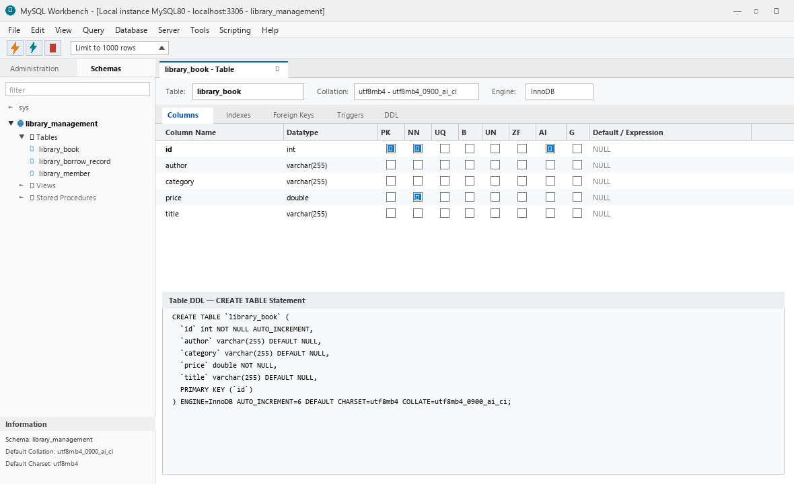
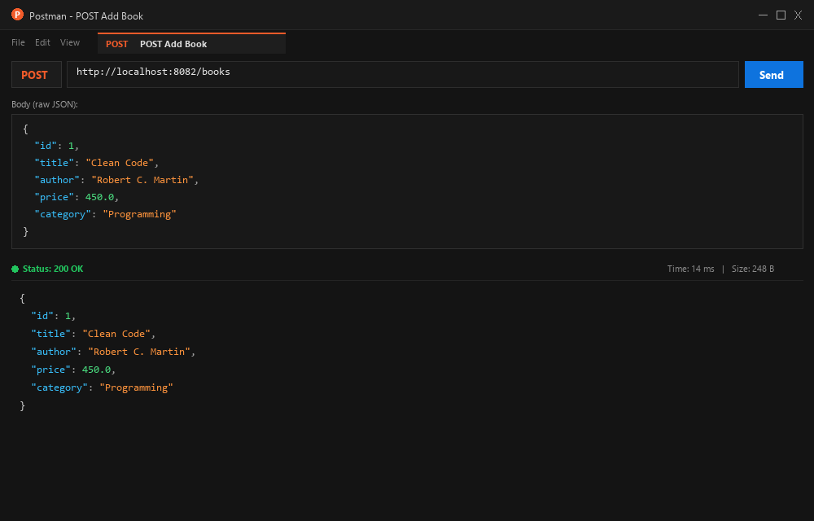
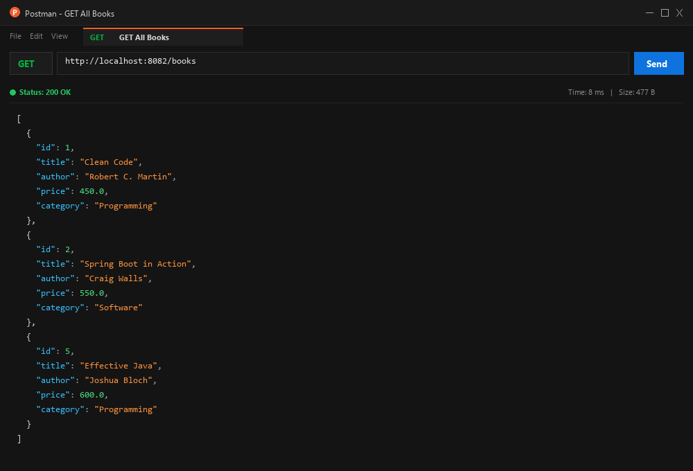
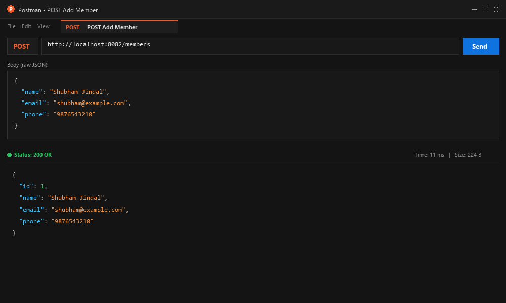
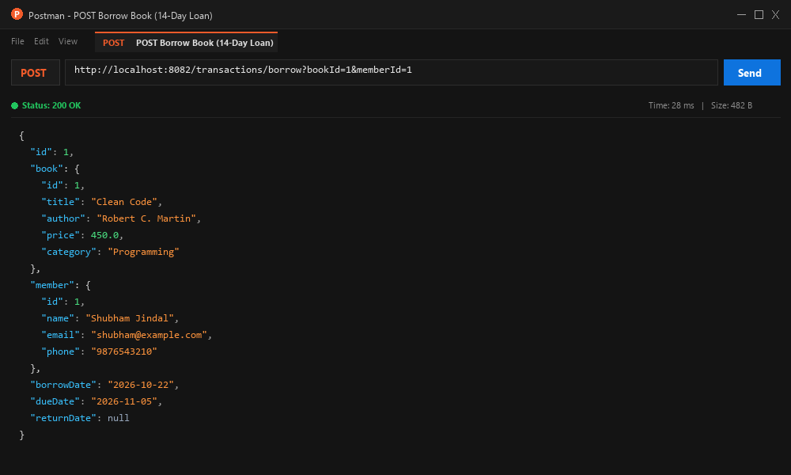
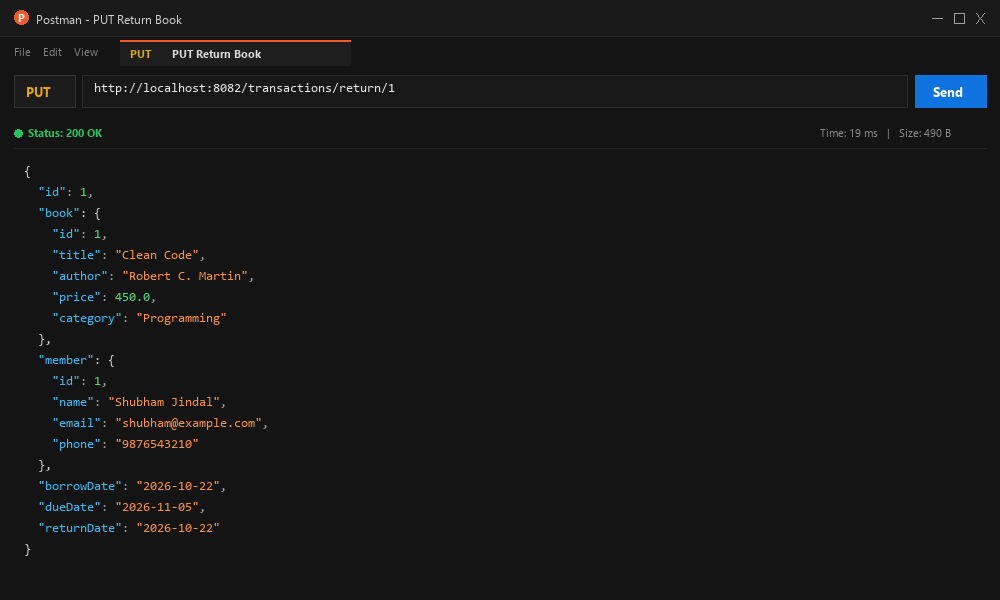
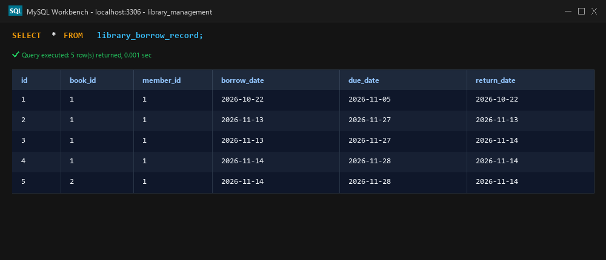
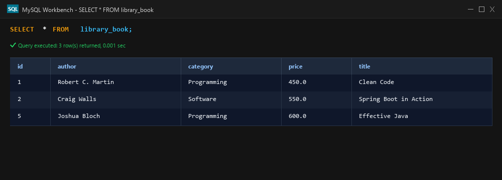
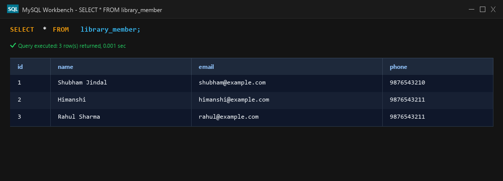

# Library Management System

A RESTful backend for managing a library's books, members and borrowing transactions, built with **Java 17, Spring Boot, Spring Data JPA (Hibernate) and MySQL**.

## Features
- Full CRUD for **books** and **members**
- **Borrowing transactions**: borrow a book (14-day loan), return it, and view all / active / per-member records
- Business rules: a book already on loan cannot be borrowed again; unknown book/member/record IDs return `404`; a double return returns `409`
- Layered architecture: Controller → Service → Repository → Entity

## Tech Stack
Java 17 · Spring Boot 3 · Spring Data JPA · Hibernate · MySQL · Maven · Postman

---

## 🖼️ API Testing & Screenshots

### 1. System Startup & Database Schema
| Spring Boot 3 Startup (Tomcat 8082 + MySQL) | Hibernate Relational Schema (MySQL) |
|---|---|
|  |  |

### 2. Project Architecture & Postman Collection
| IDE Project Structure | Postman REST API Collection (12 Endpoints) |
|---|---|
|  |  |

### 3. Book Management
| Add Book (`POST /books`) | List All Books (`GET /books`) |
|---|---|
|  |  |

### 4. Member Management & Borrowing Loans
| Member Registration (`POST /members`) | Borrow Book (14-Day Loan) (`POST /transactions/borrow`) |
|---|---|
|  |  |

### 5. Return Processing & Database Verification
| Return Book (`PUT /transactions/return`) | MySQL Database Verification (`library_borrow_record`) |
|---|---|
|  |  |

### 6. MySQL Database Tables
| Books Table (`library_book`) | Members Table (`library_member`) |
|---|---|
|  |  |

<details>
<summary><b>🔍 View Full 12-Endpoint Live Postman Test Suite</b></summary>

| # | Endpoint | Description | Screenshot |
|---|---|---|---|
| 01 | `POST /books` | Add a new book | [View Screenshot](docs/screenshots/postman-tests/01-post-add-book.png) |
| 02 | `GET /books/{id}` | Get book by ID | [View Screenshot](docs/screenshots/postman-tests/02-get-book-by-id.png) |
| 03 | `GET /books` | Retrieve all books | [View Screenshot](docs/screenshots/postman-tests/03-get-all-books.png) |
| 04 | `PUT /books/{id}` | Update book details | [View Screenshot](docs/screenshots/postman-tests/04-put-update-book.png) |
| 05 | `DELETE /books/{id}` | Delete book by ID | [View Screenshot](docs/screenshots/postman-tests/05-delete-book.png) |
| 06 | `POST /members` | Register new member | [View Screenshot](docs/screenshots/postman-tests/06-post-add-member.png) |
| 07 | `GET /members` | List all members | [View Screenshot](docs/screenshots/postman-tests/07-get-all-members.png) |
| 08 | `DELETE /members/{id}` | Delete member by ID | [View Screenshot](docs/screenshots/postman-tests/08-delete-member.png) |
| 09 | `POST /transactions/borrow` | Borrow book (14-day loan) | [View Screenshot](docs/screenshots/postman-tests/09-post-borrow-book.png) |
| 10 | `GET /transactions/active` | Retrieve active loans | [View Screenshot](docs/screenshots/postman-tests/10-get-active-loans.png) |
| 11 | `PUT /transactions/return/{id}` | Return borrowed book | [View Screenshot](docs/screenshots/postman-tests/11-put-return-book.png) |
| 12 | `GET /transactions` | Complete borrowing audit history | [View Screenshot](docs/screenshots/postman-tests/12-get-all-transactions.png) |

</details>

---

## Project Structure
```
src/main/java/com/library/management
├── controller   # REST endpoints (Book, Member, Borrow)
├── service      # business logic
├── repository   # Spring Data JPA repositories
└── entity       # Book, Member, BorrowRecord
```

## Getting Started
**Prerequisites:** JDK 17+, MySQL Database (running on `localhost:3306`).

1. Clone the repo.
2. Create your local credentials file:
   ```bash
   cp src/main/resources/application-local.properties.example src/main/resources/application-local.properties
   ```
   Then edit it with your MySQL username and password (this file is git-ignored).
3. If your DB URL differs, change `spring.datasource.url` in `application.properties`.
4. Run:
   ```bash
   ./mvnw spring-boot:run        # Windows: mvnw.cmd spring-boot:run
   ```
The app starts on **http://localhost:8082**. Tables are created automatically (`ddl-auto=update`).

## API Endpoints

| Method | Endpoint | Description |
|--------|----------|-------------|
| POST | `/books` | Add a book |
| GET | `/books` | List all books |
| GET | `/books/{id}` | Get a book |
| PUT | `/books` | Update a book |
| DELETE | `/books/{id}` | Delete a book |
| POST | `/members` | Add a member |
| GET | `/members` | List all members |
| GET | `/members/{id}` | Get a member |
| PUT | `/members/{id}` | Update a member |
| DELETE | `/members/{id}` | Delete a member |
| POST | `/transactions/borrow?bookId=&memberId=` | Borrow a book |
| PUT | `/transactions/return/{recordId}` | Return a book |
| GET | `/transactions` | All borrow records |
| GET | `/transactions/active` | Books currently on loan |
| GET | `/transactions/member/{memberId}` | A member's history |

## Example Requests
```bash
# add a book
curl -X POST localhost:8082/books -H "Content-Type: application/json" \
  -d '{"id":1,"title":"Clean Code","author":"Robert C. Martin","price":450,"category":"Programming"}'

# add a member
curl -X POST localhost:8082/members -H "Content-Type: application/json" \
  -d '{"name":"Amit","email":"amit@example.com","phone":"9999999999"}'

# borrow book 1 as member 1, then return it (use the record id from the response)
curl -X POST "localhost:8082/transactions/borrow?bookId=1&memberId=1"
curl -X PUT localhost:8082/transactions/return/1
```

## Author
Shubham Jindal — [GitHub](https://github.com/Shubhamjindl) · [LinkedIn](https://linkedin.com/in/shubham-jindal)
