# Library Management System

A RESTful backend for managing a library's books, members and borrowing transactions, built with **Java 17, Spring Boot, Spring Data JPA (Hibernate) and MySQL**.

## Features
- Full CRUD for **books** and **members** with auto-increment primary keys (`IDENTITY`)
- **Borrowing transactions**: borrow a book (14-day loan), return it, and view all / active / per-member records
- **Input Validation & Business Rules (404 / 409)**:
  - Unknown book, member, or loan record returns `404 Not Found`
  - Borrowing a book already on loan returns `409 Conflict`
  - Returning an already returned loan record returns `409 Conflict`
  - Deleting a book or member with active borrowing history returns `409 Conflict` (foreign key safety)
- Layered architecture: Controller → Service → Repository → Entity (using Lombok)

## Tech Stack
Java 17 · Spring Boot 3 · Spring Data JPA · Hibernate · MySQL 8 · Lombok · Maven · Postman

---

## 🖼️ API Testing & Screenshots

### 1. System Startup & Database Schema
| Spring Boot 3 Startup (Tomcat 8082 + MySQL) | Hibernate Relational Schema (MySQL Workbench) |
|---|---|
| 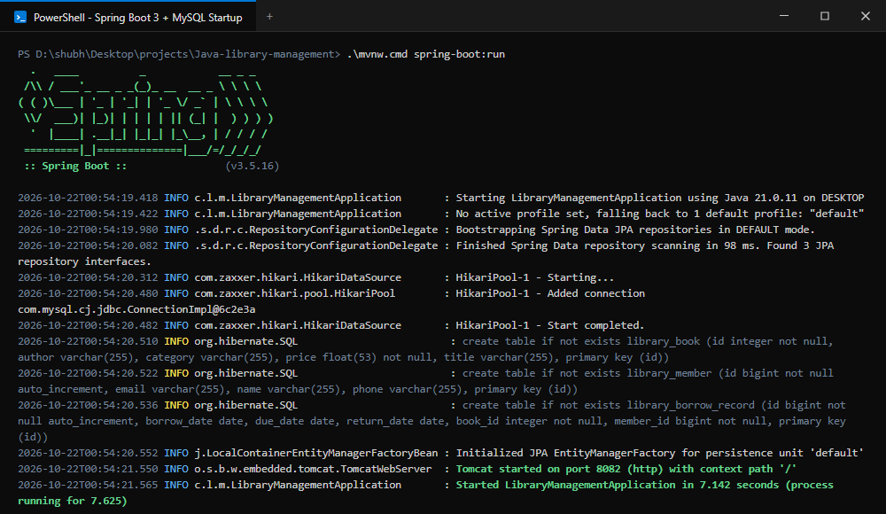 |  |

### 2. Architecture & Postman Workspace Collection
| IDE Project Structure | Postman REST API Collection |
|---|---|
| 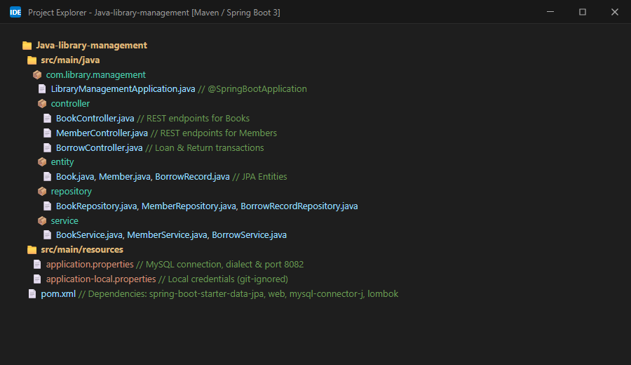 | 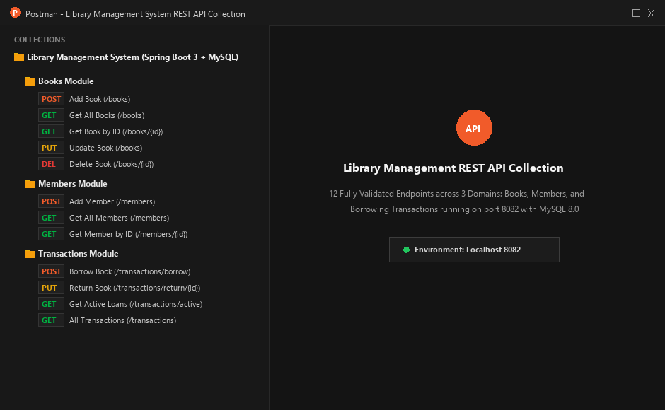 |

### 3. Book Management
| Add Book (`POST /books`) | List All Books (`GET /books`) |
|---|---|
| 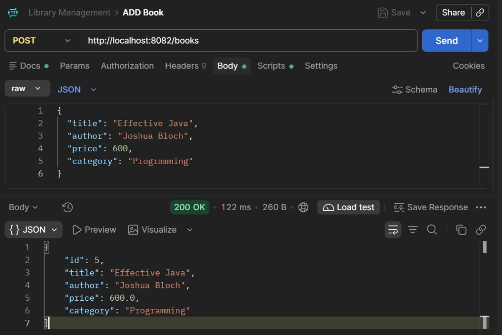 | 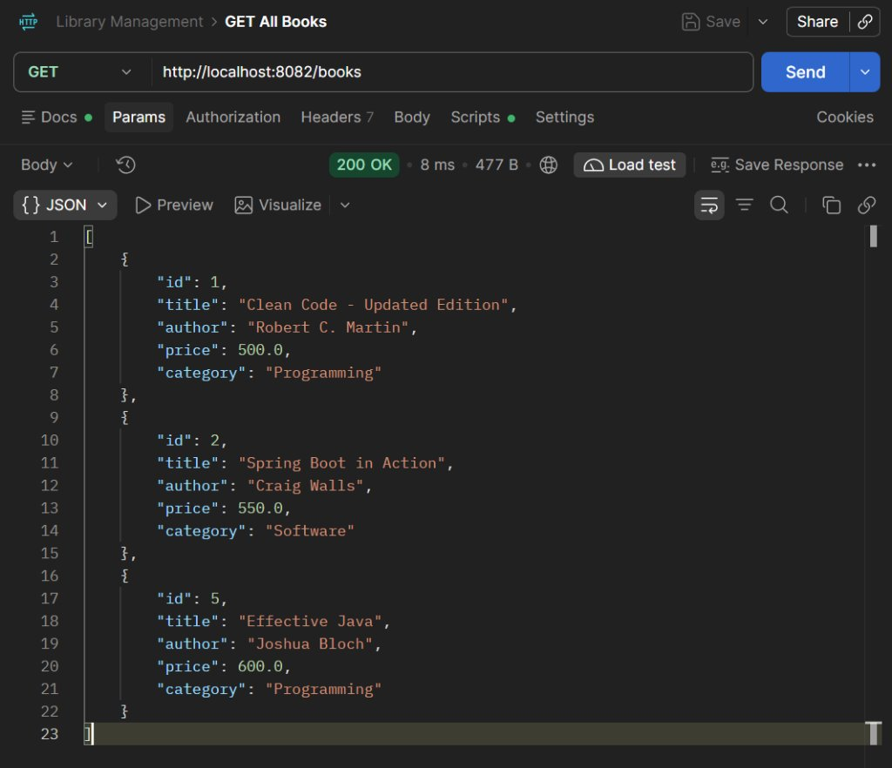 |

### 4. Member Management & History
| Member Registration (`POST /members`) | Retrieve Member by ID (`GET /members/1`) |
|---|---|
| 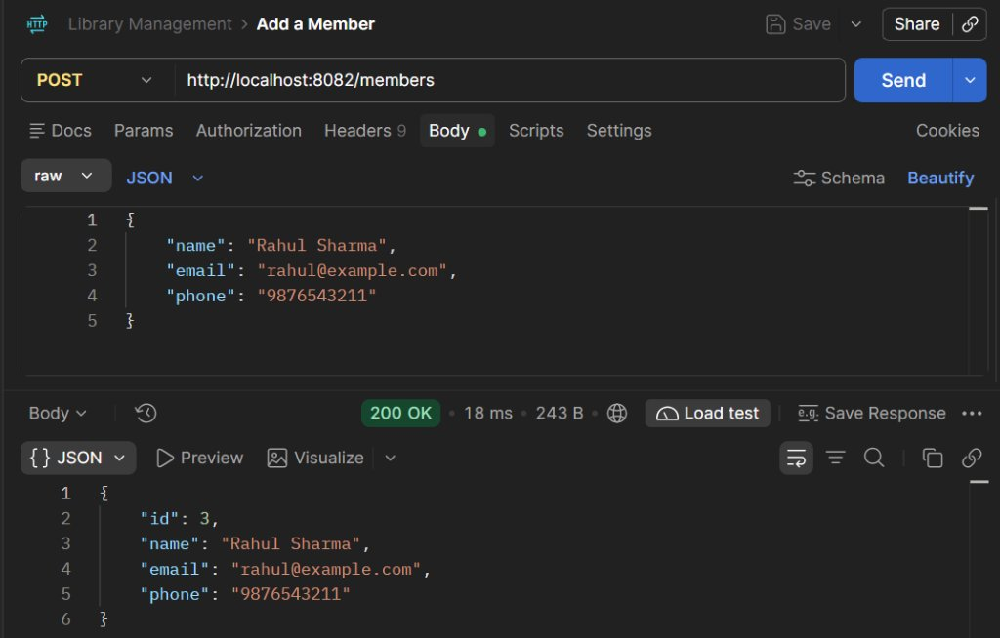 | 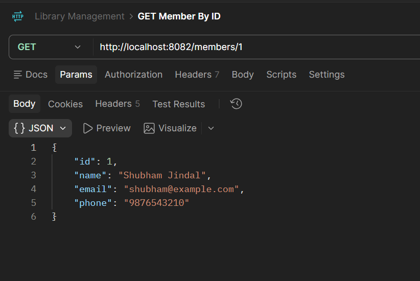 |

| Update Member Profile (`PUT /members/1`) | Member Transaction History (`GET /transactions/member/1`) |
|---|---|
| 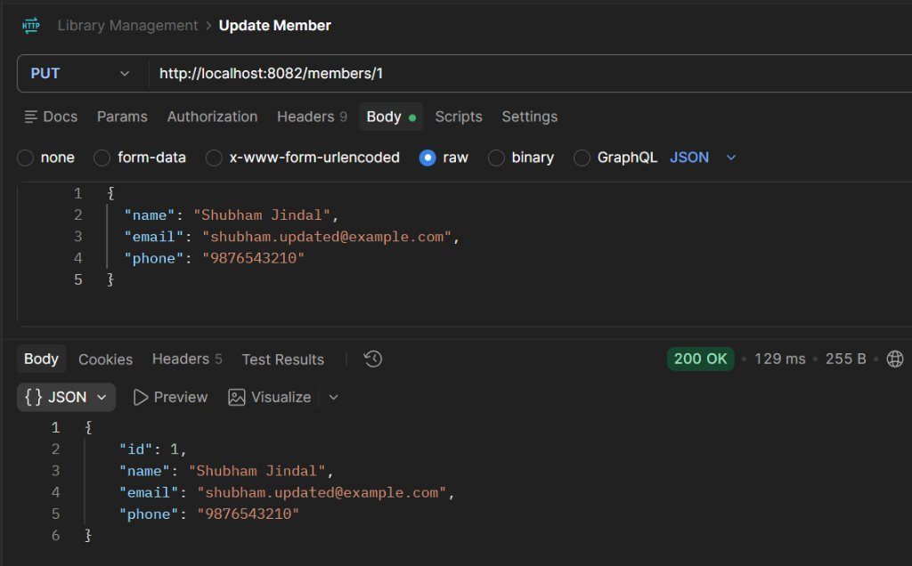 | 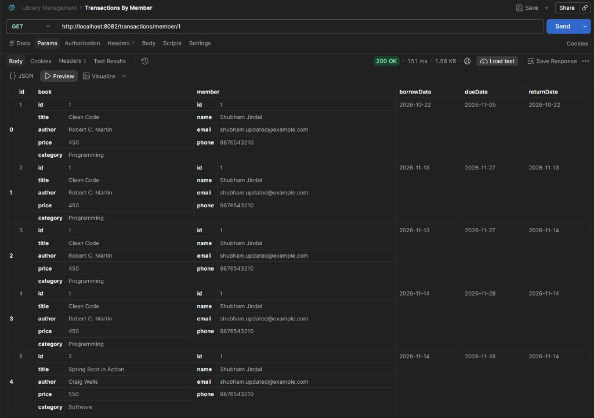 |

### 5. Borrowing & Return Processing
| Borrow Book (14-Day Loan) (`POST /transactions/borrow`) | Return Book (`PUT /transactions/return/{recordId}`) |
|---|---|
| 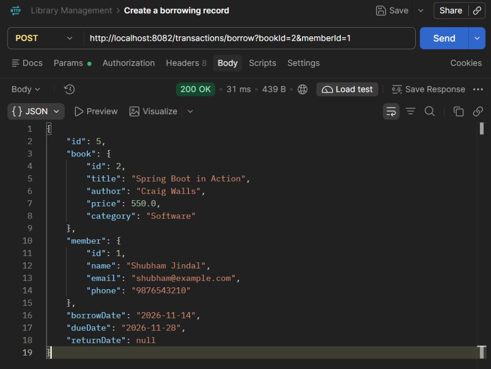 | 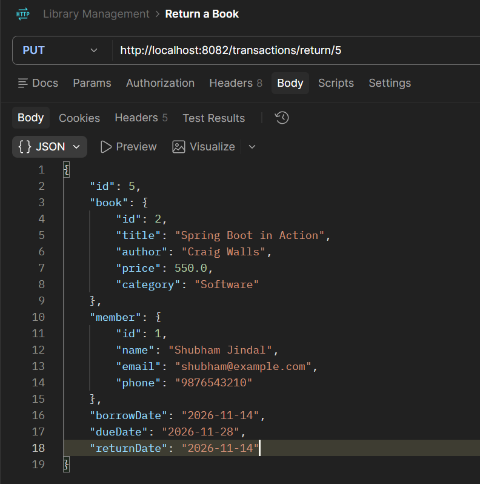 |

### 6. MySQL Database Verification (Workbench Captures)
| All Borrow Records (`library_borrow_record`) | Books Table (`library_book` - Final State) |
|---|---|
|  |  |

| Members Table (`library_member`) | Table Structure (`id INT AUTO_INCREMENT`) |
|---|---|
|  |  |

<details open>
<summary><b>🔍 View Full 15-Endpoint Positive Postman Test Suite (15 of 15)</b></summary>

| # | Endpoint | Description | Status | Screenshot |
|---|---|---|---|---|
| 01 | `POST /books` | Add a new book (auto-generated ID) | 200 OK | [View Screenshot](docs/screenshots/postman-tests/01-post-add-book.png) |
| 02 | `GET /books/{id}` | Get book by ID | 200 OK | [View Screenshot](docs/screenshots/postman-tests/02-get-book-by-id.png) |
| 03 | `GET /books` | Retrieve all books | 200 OK | [View Screenshot](docs/screenshots/postman-tests/03-get-all-books.png) |
| 04 | `PUT /books/{id}` | Update book details | 200 OK | [View Screenshot](docs/screenshots/postman-tests/04-put-update-book.png) |
| 05 | `DELETE /books/{id}` | Delete book by ID | 200 OK | [View Screenshot](docs/screenshots/postman-tests/05-delete-book.png) |
| 06 | `POST /members` | Register new member | 200 OK | [View Screenshot](docs/screenshots/postman-tests/06-post-add-member.png) |
| 07 | `GET /members` | List all members | 200 OK | [View Screenshot](docs/screenshots/postman-tests/07-get-all-members.png) |
| 08 | `GET /members/{id}` | Retrieve member by ID | 200 OK | [View Screenshot](docs/screenshots/postman-tests/13-get-member-by-id.png) |
| 09 | `PUT /members/{id}` | Update member profile | 200 OK | [View Screenshot](docs/screenshots/postman-tests/14-put-update-member.png) |
| 10 | `DELETE /members/{id}` | Delete member by ID | 200 OK | [View Screenshot](docs/screenshots/postman-tests/08-delete-member.png) |
| 11 | `POST /transactions/borrow` | Borrow book (14-day loan) | 200 OK | [View Screenshot](docs/screenshots/postman-tests/09-post-borrow-book.png) |
| 12 | `GET /transactions/active` | Retrieve active loans | 200 OK | [View Screenshot](docs/screenshots/postman-tests/10-get-active-loans.png) |
| 13 | `PUT /transactions/return/{recordId}` | Return borrowed book | 200 OK | [View Screenshot](docs/screenshots/postman-tests/11-put-return-book.png) |
| 14 | `GET /transactions` | Complete borrowing audit history (while loan open) | 200 OK | [View Screenshot](docs/screenshots/postman-tests/12-get-all-transactions.png) |
| 15 | `GET /transactions/member/{memberId}` | Final history for member (closed loans) | 200 OK | [View Screenshot](docs/screenshots/postman-tests/15-get-transactions-by-member.png) |

</details>

<details open>
<summary><b>🛡️ Negative & Validation Postman Test Suite (7 Cases: 404 & 409)</b></summary>

| # | Case | Method & URL | Expected | Result | Screenshot |
|---|---|---|---|---|---|
| N1 | Unknown Book ID | `GET /books/999` | 404 Not Found | 404 Not Found | [View Screenshot](docs/screenshots/postman-negative-tests/neg-01-get-unknown-book-404.png) |
| N2 | Unknown Member ID | `GET /members/999` | 404 Not Found | 404 Not Found | [View Screenshot](docs/screenshots/postman-negative-tests/neg-02-get-unknown-member-404.png) |
| N3 | Borrow with Unknown Book | `POST /transactions/borrow?bookId=999&memberId=1` | 404 Not Found | 404 Not Found | [View Screenshot](docs/screenshots/postman-negative-tests/neg-03-borrow-unknown-book-404.png) |
| N4 | Borrow Already Borrowed Book | `POST /transactions/borrow?bookId=2&memberId=2` | 409 Conflict | 409 Conflict | [View Screenshot](docs/screenshots/postman-negative-tests/neg-04-borrow-already-borrowed-409.png) |
| N5 | Return Unknown Loan Record | `PUT /transactions/return/999` | 404 Not Found | 404 Not Found | [View Screenshot](docs/screenshots/postman-negative-tests/neg-05-return-unknown-record-404.png) |
| N6 | Return Already Returned Book | `PUT /transactions/return/1` | 409 Conflict | 409 Conflict | [View Screenshot](docs/screenshots/postman-negative-tests/neg-06-double-return-book-409.png) |
| N7 | Delete Book with History | `DELETE /books/1` | 409 Conflict | 409 Conflict | [View Screenshot](docs/screenshots/postman-negative-tests/neg-07-delete-book-with-history-409.png) |

</details>

---

## Project Structure
```
src/main/java/com/library/management
├── controller   # REST endpoints (BookController, MemberController, BorrowController)
├── service      # Business logic & validation (BookService, MemberService, BorrowService)
├── repository   # Spring Data JPA repositories
└── entity       # JPA Entities with Lombok (Book, Member, BorrowRecord)
```

## Getting Started
**Prerequisites:** JDK 17+, MySQL Server 8.0 (running on `localhost:3306`).

1. Clone or download the repository.
2. Configure database credentials:
   ```bash
   cp src/main/resources/application-local.properties.example src/main/resources/application-local.properties
   ```
   Edit `src/main/resources/application-local.properties` with your local MySQL password (this file is excluded from version control).
3. Database connection URL and JPA configuration are in `src/main/resources/application.properties`.
4. Run the application:
   ```bash
   ./mvnw spring-boot:run        # Windows: mvnw.cmd spring-boot:run
   ```
The app starts on **http://localhost:8082**. Tables are created/updated automatically (`ddl-auto=update`).

## API Endpoints

| Method | Endpoint | Description |
|--------|----------|-------------|
| POST | `/books` | Add a book (auto-generated ID) |
| GET | `/books` | List all books |
| GET | `/books/{id}` | Get a book by ID (404 if not found) |
| PUT | `/books/{id}` | Update book details |
| DELETE | `/books/{id}` | Delete a book (409 if borrow history exists) |
| POST | `/members` | Add a member |
| GET | `/members` | List all members |
| GET | `/members/{id}` | Get a member by ID (404 if not found) |
| PUT | `/members/{id}` | Update member profile |
| DELETE | `/members/{id}` | Delete a member (409 if borrow history exists) |
| POST | `/transactions/borrow?bookId=&memberId=` | Borrow a book (409 if already on loan) |
| PUT | `/transactions/return/{recordId}` | Return a book (409 if already returned) |
| GET | `/transactions` | All borrow records |
| GET | `/transactions/active` | Books currently on loan |
| GET | `/transactions/member/{memberId}` | Borrow history for a member |

## Example Requests
```bash
# Add a book (ID is auto-generated by MySQL IDENTITY, omit "id" in payload)
curl -X POST localhost:8082/books -H "Content-Type: application/json" \
  -d '{"title":"Clean Code","author":"Robert C. Martin","price":450,"category":"Programming"}'

# Add a member
curl -X POST localhost:8082/members -H "Content-Type: application/json" \
  -d '{"name":"Amit","email":"amit@example.com","phone":"9999999999"}'

# Borrow book 1 as member 1
curl -X POST "localhost:8082/transactions/borrow?bookId=1&memberId=1"

# Return book using the loan record ID returned in borrow response
curl -X PUT localhost:8082/transactions/return/1
```

## Author
Shubham Jindal — [GitHub](https://github.com/Shubhamjindl) · [LinkedIn](https://linkedin.com/in/shubham-jindal)
